# AI-Powered Multimodal Construction Intelligence Platform

A full-stack, enterprise-grade decision-support ecosystem designed to assist construction professionals across multiple stages of construction planning, execution, and monitoring.

The platform integrates a **React.js frontend** with a **FastAPI-based Python backend**, powered by **Multimodal Artificial Intelligence (Google Gemini)** and strict JSON-based data contracts.

---

## 🌟 Core Features & Modules

### 1. Construction Site Safety Monitoring (Vision AI)
- **Multimodal Visual Inspection**: Scans construction photos and drone feeds.
- **PPE Compliance Checklist**: High-confidence detection of Hard Hats/Helmets, High-Visibility Vests, Safety Boots, and Fall Arrest Harnesses.
- **Physical Hazard Detection**: Flags critical risks (e.g., unprotected floor edges, missing scaffolding bracing, tripping hazards).
- **Corrective Directives**: Generates immediate action points and an overall site safety index (0–100).

### 2. Structural Crack Detection and Diagnostics (Vision AI)
- **Forensic Concrete Analysis**: Analyzes photos of beams, columns, foundation slabs, and masonry walls.
- **Crack Geometry & Classification**: Differentiates shear, flexural, settlement, thermal, and plastic shrinkage cracks with width estimations (mm).
- **Structural Integrity Score**: Delivers an integrity rating and safe-for-occupancy verification.
- **Repair Protocols**: Prescribes engineering retrofitting solutions (e.g., low-viscosity epoxy pressure injection, CFRP wrapping, grouting).

### 3. Construction Project Planning & WBS Engine
- **Automated Work Breakdown Structure (WBS)**: 4-phase sequential schedule (Substructure, Superstructure, MEP/HVAC, Finishes & Handover).
- **Critical Path Identification**: Highlights schedule-critical activities with week-by-week durations.
- **Milestone Roadmap**: Cashflow trigger points and deliverable checkpoints.
- **Risk Register**: Evaluates probability, impact, and mitigation strategies.

### 4. Real Estate Valuation & Cost Estimation
- **Multi-Factor Appraisal**: Factors in built-up area, location tier, construction quality, amenities, and structural age.
- **Replacement Cost Breakdown**: Segmented into Land, Civil Structure, Finishing & MEP, and Permits/Contingency.
- **Market Valuation Range**: Provides min-max price bands, price per sq.ft, and 5-year capital appreciation ROI projections.

### 5. Daily Site Assistant & Digital Field Log
- **Daily Operations Logging**: Records workforce attendance, weather conditions, equipment deployed, and activities completed.
- **Productivity Scoring**: Analyzes schedule deviations and bottleneck causes.
- **Next-Day Priorities & Restock**: Generates priority punch lists and material reorder threshold alerts.

### 6. Weather-Aware Advisory Engine
- **Micro-Climate Telemetry**: Inputs temperature, wind velocity, humidity, and precipitation probability.
- **Activity Feasibility Matrix**: Real-time traffic-light indicators (Safe / Caution / Halt) for concrete pouring, tower crane lifting, trench excavation, and exterior painting.
- **Thermal & Wind Protocols**: Concrete curing guidance and worker heat/cold stress management.

### 7. Civil Engineering Knowledge AI Consultant
- **Interactive Multi-Turn Assistant**: Clarifies structural design queries, mix designs, and seismic detailing.
- **Standards Citations**: References Indian Standards (IS 456, IS 1893, IS 10262, IS 13920), NBC 2016, ACI 318, and OSHA 1926.

---

## 🏗️ Technical Architecture

```mermaid
flowchart TD
    User["Construction Engineer / Project Manager"]
    
    subgraph Frontend["React.js Web Application (Port 5173)"]
        UI["Tailwind CSS + Lucide Icons Dashboard"]
        State["Client State & Media Upload Handler"]
    end

    subgraph Backend["FastAPI Python Backend (Port 8000)"]
        Router["API Routers (/api/v1)"]
        Schemas["Pydantic Strict JSON Contracts"]
        GeminiSvc["Gemini Service (Multimodal Vision + LLM)"]
        MockSvc["High-Fidelity Engineering Mock Engine"]
    end

    subgraph AI["Google Cloud Generative AI"]
        Gemini["Gemini 1.5 Flash / Pro Multimodal Model"]
    end

    User -->|Images, Telemetry & Scope| UI
    UI --> State
    State -->|HTTP Multipart / JSON| Router
    Router --> Schemas
    Schemas --> GeminiSvc
    GeminiSvc -->|Live API Key| Gemini
    GeminiSvc -.->|Fallback / Demo Mode| MockSvc
    Gemini -->|Structured JSON Output| GeminiSvc
    GeminiSvc --> Router
    Router -->|Validated Response| State
    State --> UI
```



---

## 📁 Directory Structure

```
mutlimodel construction/
├── backend/
│   ├── app/
│   │   ├── api/
│   │   │   ├── safety.py         # Site safety vision routes
│   │   │   ├── cracks.py         # Crack detection vision routes
│   │   │   ├── planning.py       # Project planning & WBS routes
│   │   │   ├── valuation.py      # Real estate valuation routes
│   │   │   ├── daily_site.py     # Daily site assistant routes
│   │   │   ├── weather.py        # Weather advisory routes
│   │   │   ├── knowledge.py      # Civil knowledge assistant chat
│   │   │   └── system.py         # System health & API key updates
│   │   ├── core/
│   │   │   ├── config.py         # Environment settings
│   │   │   └── prompts.py        # Domain-specific JSON schema prompts
│   │   ├── models/
│   │   │   └── schemas.py        # Pydantic data contract models
│   │   ├── services/
│   │   │   ├── gemini_service.py # Gemini Multimodal API integration
│   │   │   └── mock_service.py   # High-fidelity domain mock generator
│   │   └── main.py               # FastAPI application setup
│   ├── sample_images/            # High-resolution test images
│   ├── requirements.txt          # Python dependencies
│   ├── test_api.py               # Automated test suite (10/10 tests)
│   └── .env.example              # Environment variables template
├── frontend/
│   ├── src/
│   │   ├── components/           # Module UI tabs and modals
│   │   ├── services/             # Frontend API client
│   │   ├── App.jsx               # Main React dashboard layout
│   │   └── main.jsx
│   ├── public/sample_images/     # Preset images for 1-click demos
│   └── package.json
├── run_backend.bat               # 1-Click backend launcher
├── run_frontend.bat              # 1-Click frontend launcher
├── start_all.bat                 # Unified 1-click launcher for both
└── README.md
```

---

## 🚀 Quick Start Guide

### Option 1: 1-Click Unified Launch (Windows)
Double-click `start_all.bat` in the project root directory. It will automatically launch the backend server on port 8000 and the frontend on port 5173.

### Option 2: Manual Terminal Execution

#### 1. Backend (FastAPI)
```powershell
cd backend
# Using the pre-configured virtual environment
.\venv\Scripts\uvicorn.exe app.main:app --host 127.0.0.1 --port 8000 --reload
```
API Documentation will be live at: **http://localhost:8000/docs**

#### 2. Frontend (React + Vite)
```powershell
cd frontend
npm run dev
```
Open your browser at: **http://localhost:5173**

---

## 🔑 Google Gemini API Key Configuration
- The platform functions out-of-the-box with **High-Fidelity Demo Presets** for all 7 modules.
- To enable real-time multimodal analysis on your own photos, click the **"API Key"** button in the top navigation bar and enter your key from [Google AI Studio](https://aistudio.google.com/app/apikey), or set `GEMINI_API_KEY` in `backend/.env`.

---

## 🧪 Automated Testing
Run the comprehensive test suite verifying all 10 endpoints:
```powershell
cd backend
.\venv\Scripts\python.exe test_api.py
```
Expected output:
```
================ ALL 10 TESTS PASSED WITH 100% SUCCESS ================
```
